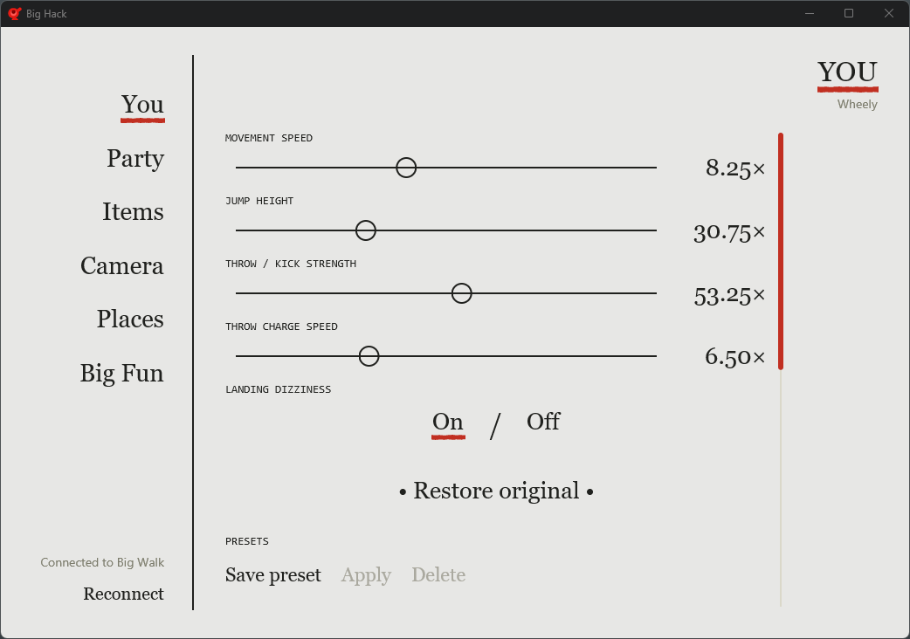
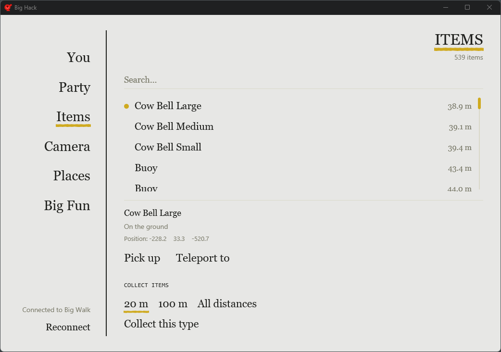
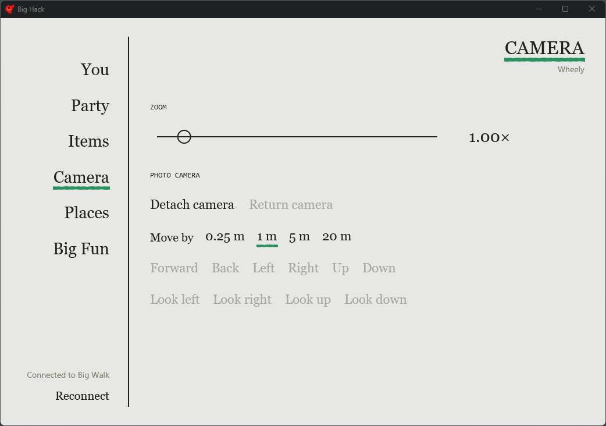
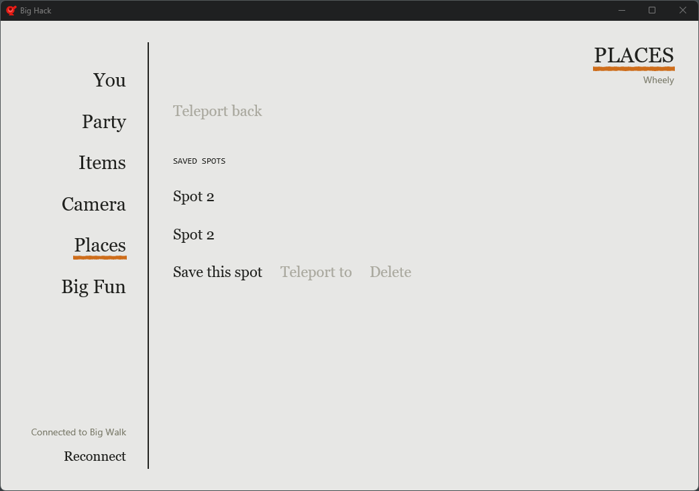
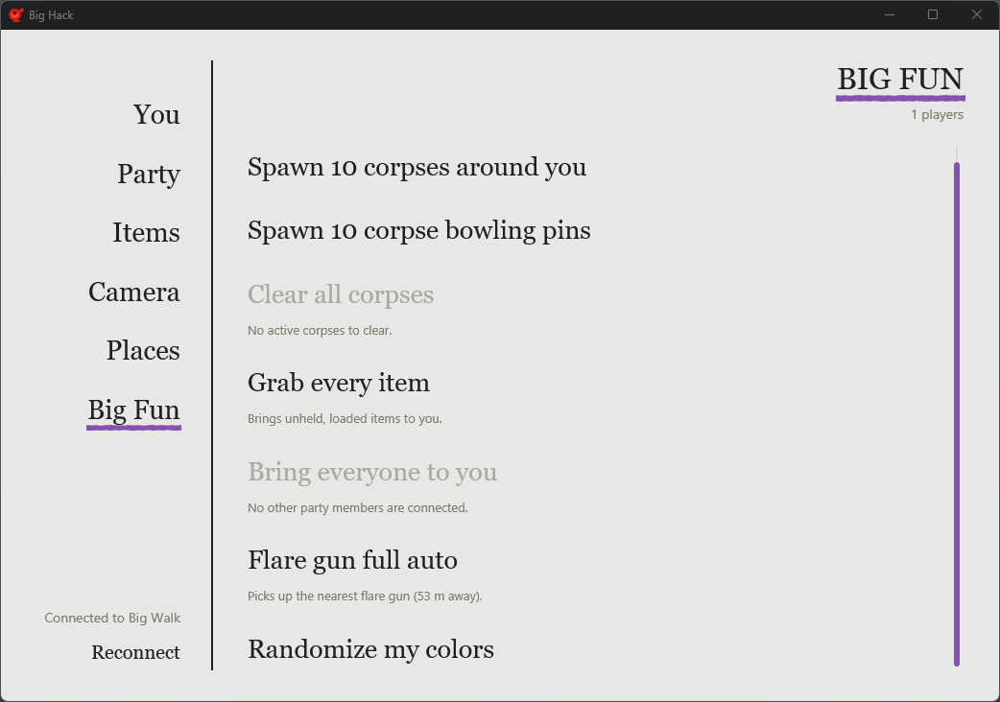

# Big Hack

A Windows companion app for private Big Walk sessions.

**[Download BigHack.exe](https://github.com/michaeldewey10/big-hack/releases/latest/download/BigHack.exe)**

1. Start Big Walk and join a session.
2. Open BigHack.exe. It finds the game and attaches automatically.

Supports Steam build `25723723` only; other versions show a warning. Some Big Fun actions need you to host.

MIT licensed. See [CHANGELOG.md](CHANGELOG.md), [THIRD-PARTY-NOTICES.md](THIRD-PARTY-NOTICES.md), and [development notes](docs/DEVELOPMENT-NOTES.md).
